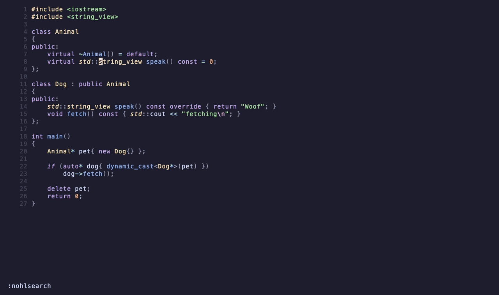

# learncpp.nvim

Read [learncpp.com](https://www.learncpp.com) inside Neovim, in your own colorscheme, and jump from a C++ name or
operator in your code to the lessons that explain it.



- **Browse** all lessons in table-of-contents order, with a preview.
- **Look up** the symbol under the cursor: `std::string_view`, `dynamic_cast`, `->`, `<<`, `#include` ...
- **Search** the full text of every lesson, offline.
- **Read** lessons as rendered Markdown: boxed code with C++ highlighting, coloured callouts, tables, links to other
  lessons that open in Neovim, and quiz solutions that stay folded until you ask for them.

## Requirements

- Neovim 0.10 or newer (developed on 0.12) and `curl`
- Tree-sitter parsers for `markdown`, `markdown_inline` and `cpp`
- Optional: [snacks.nvim](https://github.com/folke/snacks.nvim) for the picker (falls back to `vim.ui.select`),
  [render-markdown.nvim](https://github.com/MeanderingProgrammer/render-markdown.nvim) and a Nerd Font for the boxed
  look

## Install

With [lazy.nvim](https://github.com/folke/lazy.nvim):

```lua
{
  "AlexAlexBabarika/learncpp.nvim",
  cmd = "LearnCpp",
  keys = {
    { "<leader>cL", function() require("learncpp").lookup() end, mode = { "n", "x" }, desc = "LearnCpp Lookup" },
    { "<leader>sL", function() require("learncpp").toc() end, desc = "LearnCpp Lessons" },
  },
  opts = {},
}
```

The first command downloads the lessons (a few seconds) and caches them; everything after that works offline.

## Commands

| Command                    | What it does                                                            |
| -------------------------- | ----------------------------------------------------------------------- |
| `:LearnCpp`                | Pick a lesson from the table of contents                                |
| `:LearnCpp lookup [name]`  | Lessons about `name`, the visual selection, or the symbol at the cursor |
| `:LearnCpp search [words]` | Full-text search; opens the lesson at the matching line                 |
| `:LearnCpp open <ref>`     | Open by number (`25.7`), URL, slug or part of the title                 |
| `:LearnCpp resume`         | Reopen the lesson you read last                                         |
| `:LearnCpp next` / `prev`  | Neighbouring lesson                                                     |
| `:LearnCpp sync`           | Download the lessons again                                              |

Inside a lesson:

| Key         | What it does                                                                      |
| ----------- | --------------------------------------------------------------------------------- |
| `<CR>`      | Follow the link under the cursor, or reveal / hide a solution, hint or task list  |
| `]l` / `[l` | Next / previous lesson                                                            |

## Configuration

These are the defaults:

```lua
require("learncpp").setup({
  cache_dir = vim.fn.stdpath("cache") .. "/learncpp",
  open = "edit", -- where a lesson opens: "edit" | "split" | "vsplit" | "tab"
  style = true, -- boxed code, callouts and solutions; uses render-markdown.nvim when it is installed
  win = { -- window options while a lesson is shown
    wrap = true,
    linebreak = true,
    breakindent = true,
    breakindentopt = "list:-1",
    spell = false,
    list = false,
    number = false,
    relativenumber = false,
    cursorline = false,
    colorcolumn = "",
    signcolumn = "yes:1",
    statuscolumn = "",
    foldcolumn = "0",
  },
  keys = { follow = "<CR>", next = "]l", prev = "[l" }, -- set one to false to leave it unmapped
})
```

The boxed look only applies to lesson buffers; your render-markdown.nvim configuration for other Markdown files is
left alone. Box colours are derived from the current colorscheme.

## How lookup works

learncpp.com maintains its own index of terms and operators, so `->` resolves to the lesson on member selection
without guessing. That index does not cover the last chapters yet; anything it lacks is ranked by where the name
appears in the lesson text (title, headings, definitions, mentions).

## Content

The lessons are written by Alex and the learncpp.com contributors and belong to them. This plugin contains none of
their text: it downloads the lessons through the site's public API into a cache on your machine for your own
reading. The site allows private copies and asks that they not be redistributed, so please do not publish your
cache. If the tutorials help you, consider [supporting the site](https://www.learncpp.com/about/).

## Development

```sh
nvim --headless -u NONE -l tests/html.lua
nvim --headless -u NONE -l tests/store.lua
nvim --headless -u NONE -l tests/search.lua
nvim --headless -u NONE -l tests/reader.lua
```

The showcase is recorded with [VHS](https://github.com/charmbracelet/vhs): `vhs demo/demo.tape`.
